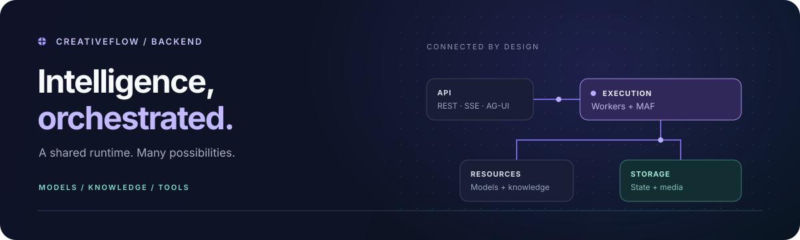
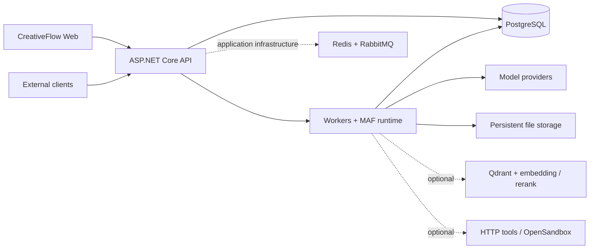

<div align="center">



# CreativeFlow Backend

**Turn creative ideas and business logic into executable AI workflows.**

A self-hosted .NET backend for media creation, visual orchestration, knowledge retrieval, and Agent tools.

[](global.json)
[](docs/architecture.md)
[](docker-compose.yml)
[](LICENSE)

[Quick start](#quick-start-isolated-local-api) · [Architecture](#architecture) · [API integration](#publish-once-integrate-your-way) · [Documentation](docs/README.md) · [Frontend ↗](https://github.com/233i/creativeflow-frontend)

**English** · [简体中文](README.zh-CN.md)

</div>

---

## One platform. Two purpose-built workflows.

Connect model providers, your knowledge, external services, and reusable assets. Media creation and general orchestration share a management layer without being forced into the same graph model.

|                   | Media creation                                                                            | General orchestration                                                                                       |
| ----------------- | ----------------------------------------------------------------------------------------- | ----------------------------------------------------------------------------------------------------------- |
| Designed for      | Image and video production                                                                | Knowledge answers and business automation                                                                   |
| Building blocks   | Prompts, reference images, generation, video extension, frame extraction                  | LLMs, parameter extraction, intent classification, transformations, branches, loops, batches, HTTP, scripts |
| Deliverables      | Reusable image and video assets                                                           | Typed outputs, structured data, answers with checked citations                                              |
| Shared foundation | Fixed published versions, durable runs, resource permissions, recovery, and external APIs | The same foundation, with a separate editor and execution contract                                          |

The free-form AI canvas is another interaction surface—not another name for a workflow definition.

## Built around the complete run

- **Model and media infrastructure.** Manage channels, capabilities, and enabled model selections. Run image/video jobs asynchronously; distinguish querying a result, saving it again, and generating again.
- **Knowledge with traceable evidence.** Preview semantic chunks, activate an index version, use vector/keyword/hybrid retrieval, and optionally rerank. Preserve source ranges, adjacent context, and citation checks.
- **Durable execution.** Queue accepted runs and persist graph snapshots, node results, and progress. Closing a page does not cancel a submitted workflow. Debugging, retries, skips, and checkpoint-based reruns follow explicit constraints.
- **Assets beyond database blobs.** Keep metadata and access rules in PostgreSQL; stream media from persistent file storage with video Range support. Reuse assets, inspect references, and manage their lifecycle.
- **Agent tools with boundaries.** Integrate MCP, Skills, canvas tools, and optional OpenSandbox execution while retaining tool approval and event ordering.
- **Integration without a second engine.** REST, custom SSE, and AG-UI expose existing execution. API keys, resource grants, idempotency, and concurrency checks remain part of that path.

## Architecture



**MAF is the single Agent/workflow execution engine.** Business services still own validation, authorization, approvals, durable state, and recovery. Redis/RabbitMQ support application infrastructure; they do not replace the database-backed workflow queue and results.

The backend separates domain rules, application use cases, infrastructure adapters, and API composition. Business dependencies use constructor injection; workflow nodes have dedicated executors. See [architecture](docs/architecture.md) and [storage design](docs/data-model.md).

## Quick start: isolated local API

### 1. Prepare your instance

Requirements: **Git, OpenSSL, and Docker with Compose v2**. Docker builds the API; no host .NET SDK is required for this path. Use a fresh checkout and independent local resources.

```bash
git clone https://github.com/233i/creativeflow-backend.git
cd creativeflow-backend
cp .env.example .env

# Generate a different value for each password/pepper.
openssl rand -hex 32
# Generate the encryption key separately: exactly 32 decoded bytes.
openssl rand -base64 32
```

Edit the ignored `.env` before starting:

| Variable            | What to set                                      |
| ------------------- | ------------------------------------------------ |
| `POSTGRES_PASSWORD` | A new random database password                   |
| `RABBITMQ_PASSWORD` | A different random broker password               |
| `ADMIN_PASSWORD`    | A strong bootstrap administrator password        |
| `DEVICE_PEPPER`     | An independent random secret                     |
| `AI_ENCRYPTION_KEY` | The Base64 output above—not a hexadecimal string |
| `PUBLIC_ORIGIN`     | `http://localhost:3000` for the frontend below   |

> Keep `AI_ENCRYPTION_KEY` stable and backed up: it protects saved credentials. Changing bootstrap passwords later does not reset existing database, broker, or administrator accounts.

### 2. Start and check the API

```bash
docker compose up -d --build
docker compose ps
curl --retry 20 --retry-delay 3 --retry-all-errors --max-time 10 \
  -fsS http://localhost:5298/health/ready
curl -fsS http://localhost:5298/health/live
```

Open **[Swagger →](http://localhost:5298/swagger/index.html)**. The first build may take several minutes.

The base stack includes PostgreSQL 18, Redis 8, RabbitMQ 4, a storage initializer, and the API. Ports bind to **127.0.0.1**; data and files use persistent volumes. Readiness checks core dependencies, not optional models. For port conflicts or Podman, see [local development](docs/local-development.md#isolated-compose-stack).

### 3. Add the web application

This repository serves the API, not the browser UI. In another terminal, clone the frontend, install the Node version in its `.node-version`, and run:

```bash
git clone https://github.com/233i/creativeflow-frontend.git
cd creativeflow-frontend
npm ci
cp .env.example .env.development.local
npm run dev
```

Open **[Administration →](http://localhost:3000/admin)**. Sign in with `ADMIN_USERNAME` (default `admin`) and your bootstrap password, then change the initial password. For the canvas at `/`, register a separate ordinary account.

### 4. Run your first workflow—without a model key

Import [startup-echo.workflow.json](docs/examples/startup-echo.workflow.json) in the workflow center and submit:

```text
Input   message = Hello CreativeFlow
Flow    Start → End
Output  result  = Hello CreativeFlow
```

This checks the queue/worker/result path without a paid model call. [Complete local acceptance](docs/local-development.md#accept-the-complete-local-installation) also covers uploads, asset reuse, and persistence after restart. Configure providers and models before trying generation.

<details>
<summary><strong>Stop or restart without erasing data</strong></summary>

```bash
docker compose down
docker compose up -d
```

Do not use `down -v` unless intentionally erasing this instance. This Compose stack is a local starting point, not a production deployment manifest.

</details>

## Publish once. Integrate your way.

| Your client needs                              | Use                             | Contract                                            |
| ---------------------------------------------- | ------------------------------- | --------------------------------------------------- |
| A task ID and a final result                   | REST submission + polling       | [REST workflow API](docs/workflow-api-streaming.md) |
| Existing custom progress events                | REST submission + `eventsUrl`   | [Custom SSE](docs/workflow-api-streaming.md)        |
| Named node events and resumable event delivery | AG-UI submission + event replay | [AG-UI workflow API](docs/ag-ui-workflow-api.md)    |

Published versions and run snapshots are fixed. A workflow grant does **not** automatically grant access to knowledge libraries, HTTP credentials, or assets. AG-UI is a transport adapter: `threadId` does not automatically provide workflow conversation memory.

## Enable the capabilities you need

| Capability                           | Additional setup                                                                                                                                        |
| ------------------------------------ | ------------------------------------------------------------------------------------------------------------------------------------------------------- |
| Text, vision, image, or video models | Credentials, compatible protocols/capabilities, and applicable endpoint permissions — [model guide](docs/ai-canvas-api.md)                              |
| Knowledge retrieval                  | Qdrant in the permitted loopback topology, an embedding model with saved dimensions, and knowledge configuration — [knowledge guide](docs/knowledge.md) |
| Reranking                            | A separate rerank model and endpoint permission; vector search is the default, not hybrid                                                               |
| Python / JavaScript scripts          | Explicitly enabled OpenSandbox infrastructure — [sandbox setup](docs/local-development.md#optional-opensandbox)                                         |
| External HTTP operations             | Node request configuration and scoped, versioned credentials — [HTTP nodes](docs/workflow-http-request-node.md)                                         |

Knowledge ingestion currently accepts **UTF-8 TXT/Markdown**, not PDF/DOCX/Excel/OCR. Loop/batch bodies have bounded node and concurrency policies. Checkpoint rollback creates a derived run; it does not undo external side effects. See [workflow boundaries](docs/workflows.md).

## Develop and deploy

```text
src/
├── CreativeFlow.Domain/           Business entities and invariants
├── CreativeFlow.Application/      Use cases, contracts, node executors
├── CreativeFlow.Infrastructure/   MAF, model protocols, persistence, storage
└── CreativeFlow.Api/              HTTP, SignalR, dependency composition
db/migrations/                    Ordered database migrations
tests/                            Unit, contract, and integration checks
deploy/                           Environment and deployment templates
```

For source development, install the SDK pinned in [global.json](global.json) and follow [local setup](docs/local-development.md#run-the-api-from-source).

```bash
dotnet restore CreativeFlow.slnx --locked-mode
dotnet build CreativeFlow.slnx
dotnet test CreativeFlow.slnx --no-restore
```

Database-dependent tests require a disposable test database. The [test guide](docs/local-development.md#tests) documents fixture limitations and dependency advisories; a healthy startup is not a claim that every quality or security gate passes.

| Next step                        | Guide                                                                                                        |
| -------------------------------- | ------------------------------------------------------------------------------------------------------------ |
| Deploy a server                  | [Configuration](docs/configuration.md) → [Deployment](docs/deployment.md) → [Operations](docs/operations.md) |
| Upgrade an existing installation | [Data and migrations](docs/data-model.md#升级已有实例)                                                       |
| Understand authorization         | [Accounts, administrators, and API keys](docs/authentication.md)                                             |
| Extend the backend               | [Architecture](docs/architecture.md) · [Coding standards](docs/coding-standards.md)                          |
| Explore all references           | [Documentation index](docs/README.md)                                                                        |

> **Protect the installation.** Preserve migrations **0001–0045 and their checksum file unchanged**. Do not commit secrets or runtime files. Back up the database, file volumes, and encryption key together; review HTTPS, outbound permissions, resource grants, and Swagger exposure before production. Older database-blob installations need an explicit file migration plan before upgrade.

## License and attribution

CreativeFlow is derived from [AIDotNet/Sol](https://github.com/AIDotNet/Sol). The upstream **MIT License** and `Copyright (c) 2026 AIDotNet` notice are preserved in [LICENSE](LICENSE).

This attribution does not imply upstream maintenance or endorsement. Third-party dependencies and provider marks retain their respective licenses and rights.
