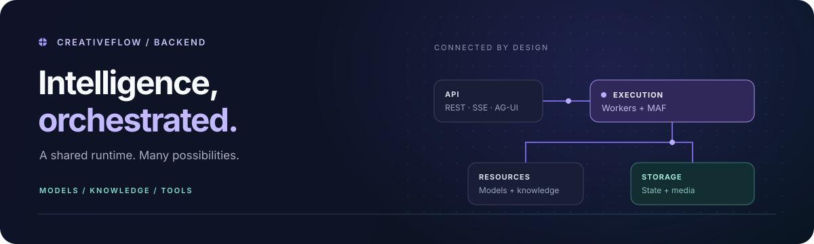
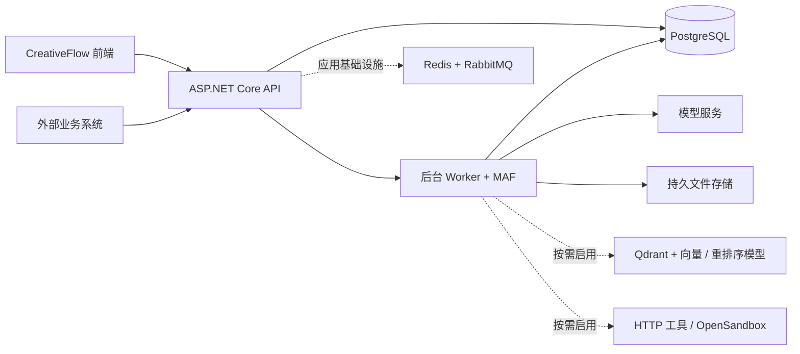

<div align="center">



# CreativeFlow 后端

**让创作灵感与业务逻辑，成为真正可执行的 AI 工作流。**

可自行部署的 .NET 后端，连接媒体创作、可视化编排、知识检索与 Agent 工具。

[](global.json)
[](docs/architecture.md)
[](docker-compose.yml)
[](LICENSE)

[快速开始](#快速开始本机独立环境) · [系统架构](#系统架构) · [对外接入](#一次发布多种接入方式) · [文档中心](docs/README.md) · [前端仓库 ↗](https://github.com/233i/creativeflow-frontend)

[English](README.md) · **简体中文**

</div>

---

## 一个管理平台，两种专业工作流

CreativeFlow 将模型服务、知识资料、外部接口与可复用素材连接起来。媒体创作与通用编排共享管理能力，但保留各自的图模型、编辑器与执行契约。

|          | 媒体创作                                           | 通用编排                                                          |
| -------- | -------------------------------------------------- | ----------------------------------------------------------------- |
| 面向场景 | 图片与视频生产                                     | 知识问答与业务自动化                                              |
| 核心节点 | 提示词、参考图、生图、生视频、视频延长、抽帧       | LLM、参数提取、意图分类、数据转换、分支、循环、批处理、HTTP、脚本 |
| 交付结果 | 可复用的图片与视频素材                             | 类型化输出、结构化数据、经过引用校验的回答                        |
| 共同基础 | 固定发布版本、持久化运行、资源权限、恢复与对外 API | 共享基础能力，不合并为同一种工作流                                |

自由 AI 画布是另一个交互入口，不等同于工作流定义。

## 不只发起调用，更管理完整执行过程

- **模型与媒体基础能力。** 统一配置渠道、模型能力与可选模型；异步生成图片和视频，明确区分“重新查询”“重新保存”和“重新生成”。
- **有来源的知识回答。** 预览语义切片、显式激活索引版本，选择向量、关键词或混合检索，并按需重排序；保留原文范围、相邻上下文与引用校验。
- **可追踪的执行。** 任务受理后入队，保存图快照、节点结果与进度；关闭页面不会取消已提交的工作流。单节点调试、重试、跳过与检查点重跑均有明确约束。
- **独立文件存储。** PostgreSQL 保存素材元数据与权限，持久文件卷保存媒体正文；支持流式下载、视频 Range、素材复用、引用检查和生命周期管理。
- **有边界的 Agent 工具。** 接入 MCP、Skills、画布工具与可选 OpenSandbox，保留工具审批与事件顺序。
- **一套执行，多种接入。** REST、自定义 SSE、AG-UI 复用现有工作流执行链路，保留 API Key、资源授权、幂等与并发控制。

## 系统架构



**Agent 与工作流只使用 MAF 执行引擎。** 原业务组件继续负责图校验、授权、审批、持久状态和恢复；Redis/RabbitMQ 不替代数据库中的工作流队列与运行结果。

代码分离领域规则、应用用例、基础设施适配与 API 装配，业务依赖通过构造函数注入，节点由独立执行器处理。详见[架构说明](docs/architecture.md)与[存储设计](docs/data-model.md)。

## 快速开始：本机独立环境

### 1. 准备配置

需要 **Git、OpenSSL、Docker 与 Compose v2**。此路径由 Docker 编译 API，无需在宿主机安装 .NET SDK。请使用新克隆目录和独立本地资源。

```bash
git clone https://github.com/233i/creativeflow-backend.git
cd creativeflow-backend
cp .env.example .env

# 密码与 pepper 分别生成，不共用同一个值。
openssl rand -hex 32
# 加密密钥单独生成：Base64 解码后恰好 32 字节。
openssl rand -base64 32
```

启动前编辑被 Git 忽略的 `.env`：

| 变量                | 填写内容                                   |
| ------------------- | ------------------------------------------ |
| `POSTGRES_PASSWORD` | 新的随机数据库密码                         |
| `RABBITMQ_PASSWORD` | 独立随机消息队列密码                       |
| `ADMIN_PASSWORD`    | 足够强的初始管理员密码                     |
| `DEVICE_PEPPER`     | 独立生成的随机秘密值                       |
| `AI_ENCRYPTION_KEY` | 上面的 Base64 输出，不能填写 hex 字符串    |
| `PUBLIC_ORIGIN`     | 配合下面的前端使用 `http://localhost:3000` |

> 长期保管并备份 `AI_ENCRYPTION_KEY`，不要每次启动重新生成，否则已有渠道凭据无法解密。修改引导密码不会重置已有数据库、消息队列或管理员账号。

### 2. 启动并检查后端

```bash
docker compose up -d --build
docker compose ps
curl --retry 20 --retry-delay 3 --retry-all-errors --max-time 10 \
  -fsS http://localhost:5298/health/ready
curl -fsS http://localhost:5298/health/live
```

打开 **[Swagger →](http://localhost:5298/swagger/index.html)**。首次构建可能需要数分钟。

默认启动 PostgreSQL 18、Redis 8、RabbitMQ 4、文件卷初始化服务与 API；端口仅绑定 **127.0.0.1**，数据和文件使用持久卷。就绪检查验证基础依赖，不代表可选模型服务已配置。端口冲突及 Podman 使用方式见[本地开发](docs/local-development.md#isolated-compose-stack)。

### 3. 启动配套前端

本仓库只提供 API，不包含网页。在另一个终端克隆前端，先安装其 `.node-version` 指定的 Node，再执行：

```bash
git clone https://github.com/233i/creativeflow-frontend.git
cd creativeflow-frontend
npm ci
cp .env.example .env.development.local
npm run dev
```

打开 **[管理后台 →](http://localhost:3000/admin)**，使用 `ADMIN_USERNAME`（默认 `admin`）及初始密码登录，然后修改初始密码。用户画布 `/` 需单独注册普通账号。

### 4. 跑通第一条工作流，不需要模型 Key

在工作流中心导入 [startup-echo.workflow.json](docs/examples/startup-echo.workflow.json)，提交：

```text
输入  message = Hello CreativeFlow
流程  开始 → 结束
输出  result  = Hello CreativeFlow
```

这一步验证基础入队、执行与结果保存，不调用收费模型。[完整启动验收](docs/local-development.md#accept-the-complete-local-installation)还包括上传、素材复用和重启持久化。需要真实生成时，再配置渠道与模型。

<details>
<summary><strong>停止或重启，不清空数据</strong></summary>

```bash
docker compose down
docker compose up -d
```

除非明确清空这个本地实例，不要执行 `down -v`。本 Compose 是本地启动方案，不是生产部署清单。

</details>

## 一次发布，多种接入方式

| 客户端需要                       | 选择                        | 接口文档                                          |
| -------------------------------- | --------------------------- | ------------------------------------------------- |
| 提交后取得任务 ID，查询最终结果  | REST 提交与轮询             | [REST 工作流 API](docs/workflow-api-streaming.md) |
| 接入现有自定义进度事件           | REST 提交后订阅 `eventsUrl` | [自定义 SSE](docs/workflow-api-streaming.md)      |
| 渲染有名称的节点事件，断线后续读 | AG-UI 提交与事件重放        | [AG-UI 工作流 API](docs/ag-ui-workflow-api.md)    |

已发布版本与运行快照固定。拥有工作流访问权**不代表**自动取得知识库、HTTP 凭据或素材权限。AG-UI 是传输适配，`threadId` 不会自动提供工作流多轮会话记忆。

## 按需启用扩展能力

| 能力                         | 还需要配置                                                                                    |
| ---------------------------- | --------------------------------------------------------------------------------------------- |
| 文本、多模态、图片与视频模型 | 渠道凭据、兼容协议/能力及对应端点许可，见[模型配置](docs/ai-canvas-api.md)                    |
| 知识检索                     | 符合回环网络策略的 Qdrant、保存实测维度的向量模型、知识库配置，见[知识库](docs/knowledge.md)  |
| 重排序                       | 单独配置重排序模型与端点许可；默认检索方式为向量检索，不是混合检索                            |
| Python / JavaScript 脚本     | 显式启用并部署 OpenSandbox，见[沙箱配置](docs/local-development.md#optional-opensandbox)      |
| 外部 HTTP 操作               | 节点中的接口配置、具有明确范围与版本的凭据，见[HTTP 节点](docs/workflow-http-request-node.md) |

知识导入目前支持 **UTF-8 TXT / Markdown**，不包含 PDF、DOCX、Excel 或 OCR。循环与批处理受子节点类型及并发策略限制。检查点回滚创建派生运行，不会撤销外部系统已经发生的副作用。详见[能力边界](docs/workflows.md)。

## 开发与部署

```text
src/
├── CreativeFlow.Domain/           业务实体与不变量
├── CreativeFlow.Application/      用例、契约与节点执行器
├── CreativeFlow.Infrastructure/   MAF、模型协议、持久化与存储
└── CreativeFlow.Api/              HTTP、SignalR 与依赖装配
db/migrations/                    顺序数据库迁移
tests/                            单元、契约与集成检查
deploy/                           环境与部署模板
```

源码开发先安装 [global.json](global.json) 固定的 SDK，按[本地开发说明](docs/local-development.md#run-the-api-from-source)准备依赖与私有配置。

```bash
dotnet restore CreativeFlow.slnx --locked-mode
dotnet build CreativeFlow.slnx
dotnet test CreativeFlow.slnx --no-restore
```

数据库相关测试需要可丢弃的独立数据库。[测试说明](docs/local-development.md#tests)保留了夹具限制与依赖告警，基础服务启动成功不等于全部质量或安全门禁通过。

| 下一步           | 文档                                                                                    |
| ---------------- | --------------------------------------------------------------------------------------- |
| 部署自己的服务器 | [配置](docs/configuration.md) → [部署](docs/deployment.md) → [运维](docs/operations.md) |
| 升级已有实例     | [数据与迁移](docs/data-model.md#升级已有实例)                                           |
| 理解权限体系     | [普通账号、管理员与 API Key](docs/authentication.md)                                    |
| 扩展后端         | [架构](docs/architecture.md) · [开发规范](docs/coding-standards.md)                     |
| 查找全部功能参考 | [文档中心](docs/README.md)                                                              |

> **保护已有数据。** 完整保留迁移 **0001–0045 及校验文件，不能修改内容**。不提交秘密值或运行产物；数据库、文件卷与加密密钥需配套备份。生产部署核对 HTTPS、出站许可、资源授权与 Swagger 暴露范围。仍使用数据库 blob 的旧实例，升级前需要单独制定文件迁移方案。

## 许可证与致谢

CreativeFlow 基于 [AIDotNet/Sol](https://github.com/AIDotNet/Sol) 二次开发，上游 **MIT License** 及 `Copyright (c) 2026 AIDotNet` 声明完整保留于 [LICENSE](LICENSE)。

该说明不代表上游维护或认可 CreativeFlow。第三方依赖与服务商标识遵循各自的许可和权利声明。
